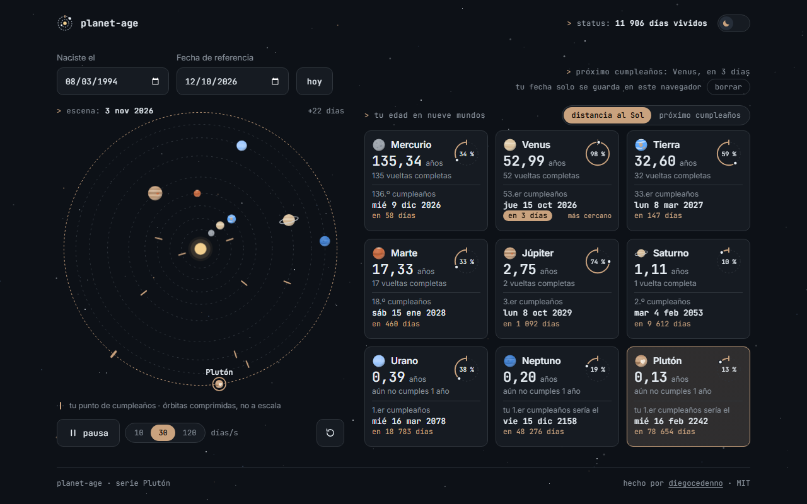

# planet-age

> Your age on every planet, and the date of your next birthday on Mercury, Mars or Pluto, with the nine worlds circling the Sun at their real relative pace.
>
> Tu edad en cada planeta y la fecha de tu próximo cumpleaños en Mercurio, Marte o Plutón, con los nueve mundos girando alrededor del Sol a su ritmo relativo real.

**[Live demo · Demo en vivo →](https://diegocedenno.github.io/planet-age/)**

**[English](#english)** · **[Español](#español)**

---

## English

### What it does

- Enter your date of birth. Each of the nine worlds gets a card: your age there with decimals, completed laps, progress through the current lap as a small orbit, the local date of your next birthday and how many days are left.
- A second field, the reference date, defaults to today (`hoy`) and answers "how old will I be on…?" or "how old was I on…?".
- The scene shows the Sun and nine dashed orbits. On each orbit a fixed mark is your birthday point — where that world was the day you were born — and the world is drawn where it is on the reference date, so the gap between the two is what is left until your birthday there. From that date the scene runs forward as a time-lapse at 10, 30 or 120 days per second; you can pause it or rewind it, and a mark flashes whenever its world completes a lap.
- Cards can be sorted by distance to the Sun or by next birthday. The closest birthday is highlighted, and so are the odd cases: on Uranus you have not turned 1 yet, and your first birthday on Pluto would come 248 years after you were born.
- Selecting a world — click, tap or keyboard, on its card or in the scene — highlights it in both places.
- Your date of birth is personal data: it is stored only in this browser (`localStorage`), the page says so, and `borrar` wipes it.
- A switch in the header flips between dark and light mode: the same sky redrawn as a star chart on paper. The choice is remembered and shared across the Plutón series.

### What makes it technically interesting

- **Pure logic, testable without a browser.** `js/ages.js` has no DOM: day counts, ages, birthdays, ordering and positions are plain functions, checked from Node against known cases (2000-01-01 → 2026-01-01 is 9497 days: 26.00 Earth years, 107.96 on Mercury, 0.10 on Pluto).
- **Calendar days, not timestamps.** Dates are counted as whole days in UTC arithmetic, so daylight saving never adds or removes an hour. The time of birth is unknown, so both ends are taken at noon and birthdays are rounded to the nearest day.
- **A real, if schematic, sky.** Each world starts from its mean longitude at J2000 and advances on a circular orbit with its sidereal period. It is a diagram, not an ephemeris — orbit radii are compressed and say so — but angular speeds are the real ones: Mercury laps the Sun 4.15 times per Earth lap and Pluto barely moves.
- **One loop, transforms only.** A single `requestAnimationFrame` advances a clock in days and writes one `transform` per world. The scene date is refreshed at about 10 Hz, the loop stops with `document.hidden`, and it waits while keyboard focus sits on a world so the focus ring does not run away.
- **Cards reorder with FLIP.** Sorting moves the cards in the DOM, so tab order always matches what you see, and each card slides from where it was with a transform.
- **Reduced motion is a first-class path.** With `prefers-reduced-motion` the loop never starts: the worlds sit at their position for the reference date, the playback controls step aside, and date changes are a plain opacity fade.
- **Gentle validation on native date inputs.** Half-typed dates are ignored instead of flagged, out-of-range ones are explained and restored on blur, and a reference date before your birth simply says "you were not born yet".
- **Accessible by construction.** The cards are the accessible view of the scene: a list with real buttons. In the SVG, the worlds form a toolbar with one tab stop and arrow-key navigation, each with a spoken label carrying its numbers.
- **Zero dependencies, zero build.** Plain HTML, CSS and JavaScript. Fonts are bundled; nothing is requested from the network.

### The numbers

Sidereal orbital periods in Earth days: Mercury 87.969 · Venus 224.701 · Earth 365.256 · Mars 686.980 · Jupiter 4332.59 · Saturn 10 759.22 · Uranus 30 688.5 · Neptune 60 182 · Pluto 90 560.

| Quantity | Formula |
| --- | --- |
| Days lived | calendar days between birth and the reference date |
| Age on a world | `days lived / period` |
| Next birthday | `birth + (⌊age⌋ + 1) × period`, rounded to the day |
| Position in the scene | `L₀ + 360° × days since J2000 / period` |

These are sidereal years: one full lap measured against the stars. Earth's is about 20 minutes longer than the calendar year, so your orbital birthday on Earth slowly drifts away from your calendar one — roughly a day every 70 years.

### Keyboard

| Key | Action |
| --- | --- |
| `Tab` | Move through the dates, the scene, its controls and the cards |
| `←` `→` `↑` `↓` in the scene | Previous / next world |
| `Home` `End` in the scene | First / last world |
| `Enter` or `Space` | Select the focused world or card |

### Run it

Double-click `index.html`. That is all — there is no build step and no server.
It also works as-is on GitHub Pages.

### License

[MIT](LICENSE) © Diego Cedeño. Inter and JetBrains Mono are bundled under the [SIL Open Font License](assets/fonts/).

---

## Español

### Qué hace

- Escribe tu fecha de nacimiento. Cada uno de los nueve mundos tiene su tarjeta: tu edad allí con decimales, las vueltas completas, el progreso de la vuelta en curso dibujado como una pequeña órbita, la fecha local de tu próximo cumpleaños y los días que faltan.
- Un segundo campo, la fecha de referencia, es hoy por defecto (`hoy`) y responde a «¿qué edad tendré el…?» o «¿qué edad tenía el…?».
- La escena muestra el Sol y nueve órbitas punteadas. En cada órbita, una marca fija es tu punto de cumpleaños —dónde estaba ese mundo el día que naciste— y el mundo se dibuja donde está en la fecha de referencia: lo que separa a los dos es lo que falta para tu cumpleaños allí. Desde esa fecha la escena avanza a cámara rápida, a 10, 30 o 120 días por segundo; se puede pausar o devolver al inicio, y una marca destella cada vez que su mundo completa una vuelta.
- Las tarjetas se ordenan por distancia al Sol o por próximo cumpleaños. El cumpleaños más cercano va destacado, igual que los casos curiosos: en Urano aún no has cumplido 1 año, y tu primer cumpleaños en Plutón llegaría 248 años después de nacer.
- Elegir un mundo —con clic, dedo o teclado, en su tarjeta o en la escena— lo resalta en los dos sitios.
- Tu fecha de nacimiento es un dato personal: solo se guarda en este navegador (`localStorage`), la página lo dice y `borrar` la elimina.
- Un interruptor en la cabecera alterna entre modo oscuro y claro: el mismo cielo redibujado como carta estelar sobre papel. La elección se recuerda y se comparte entre los proyectos de la serie Plutón.

### Qué lo hace interesante técnicamente

- **Lógica pura, comprobable sin navegador.** `js/ages.js` no toca el DOM: el recuento de días, las edades, los cumpleaños, el orden y las posiciones son funciones simples, verificadas desde Node con casos conocidos (del 2000-01-01 al 2026-01-01 hay 9497 días: 26,00 años terrestres, 107,96 en Mercurio y 0,10 en Plutón).
- **Días de calendario, no marcas de tiempo.** Las fechas se cuentan como días enteros con aritmética UTC, así el cambio de hora nunca suma ni resta una. Como la hora de nacimiento no se conoce, los dos extremos se toman a mediodía y los cumpleaños se redondean al día más cercano.
- **Un cielo real, aunque esquemático.** Cada mundo parte de su longitud media en J2000 y avanza en una órbita circular con su periodo sidéreo. Es un esquema, no una efeméride —los radios de las órbitas están comprimidos y la página lo avisa—, pero las velocidades angulares son las reales: Mercurio da 4,15 vueltas por cada una de la Tierra y Plutón apenas se mueve.
- **Un solo bucle, solo transforms.** Un único `requestAnimationFrame` adelanta un reloj en días y escribe un `transform` por mundo. La fecha de la escena se refresca a unos 10 Hz, el bucle se detiene con `document.hidden` y espera mientras el foco del teclado está sobre un mundo, para que el anillo de foco no salga corriendo.
- **Las tarjetas se reordenan con FLIP.** Ordenar mueve las tarjetas en el DOM, de modo que el orden de tabulación coincide siempre con lo que se ve, y cada una se desliza desde donde estaba con un transform.
- **El movimiento reducido es un camino de primera clase.** Con `prefers-reduced-motion` el bucle no arranca: los mundos quedan en su posición para la fecha de referencia, los mandos de reproducción se retiran y los cambios de fecha son un simple fundido de opacidad.
- **Validación amable sobre campos de fecha nativos.** Una fecha a medio teclear se ignora en lugar de marcarse como error, las que se salen de rango se explican y se restauran al salir del campo, y una fecha de referencia anterior a tu nacimiento solo dice «aún no habías nacido».
- **Accesible por construcción.** Las tarjetas son la vista accesible de la escena: una lista con botones de verdad. En el SVG, los mundos forman una barra de herramientas con un solo alto de tabulación y navegación con flechas, cada uno con una etiqueta hablada que lleva sus números.
- **Cero dependencias, cero build.** HTML, CSS y JavaScript sin más. Las fuentes van incluidas; no se pide nada a la red.

### Los números

Periodos orbitales sidéreos en días terrestres: Mercurio 87,969 · Venus 224,701 · Tierra 365,256 · Marte 686,980 · Júpiter 4332,59 · Saturno 10 759,22 · Urano 30 688,5 · Neptuno 60 182 · Plutón 90 560.

| Magnitud | Fórmula |
| --- | --- |
| Días vividos | días de calendario entre el nacimiento y la fecha de referencia |
| Edad en un mundo | `días vividos / periodo` |
| Próximo cumpleaños | `nacimiento + (⌊edad⌋ + 1) × periodo`, redondeado al día |
| Posición en la escena | `L₀ + 360° × días desde J2000 / periodo` |

Son años sidéreos: una vuelta completa medida contra las estrellas. El de la Tierra dura unos 20 minutos más que el año del calendario, así que tu cumpleaños orbital en la Tierra se va separando poco a poco del de calendario: más o menos un día cada 70 años.

### Teclado

| Tecla | Acción |
| --- | --- |
| `Tab` | Pasar por las fechas, la escena, sus mandos y las tarjetas |
| `←` `→` `↑` `↓` en la escena | Mundo anterior / siguiente |
| `Inicio` `Fin` en la escena | Primer / último mundo |
| `Enter` o `Espacio` | Elegir el mundo o la tarjeta con el foco |

### Cómo correrlo

Doble clic en `index.html`. Nada más: no hay build ni servidor.
También funciona tal cual en GitHub Pages.

### Licencia

[MIT](LICENSE) © Diego Cedeño. Inter y JetBrains Mono se incluyen bajo la [SIL Open Font License](assets/fonts/).
